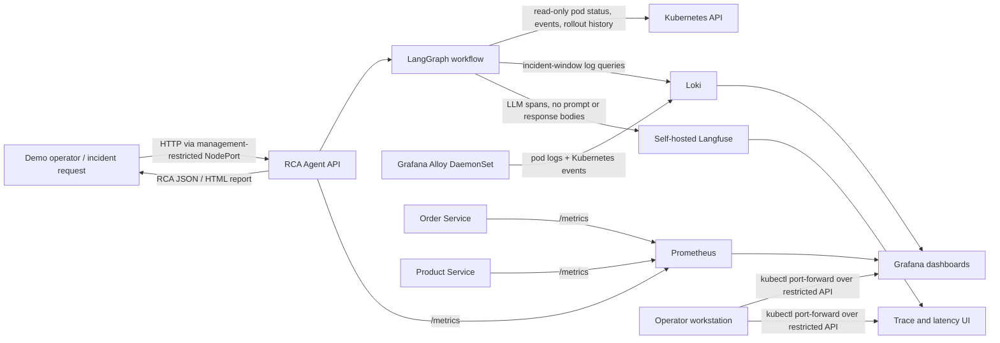

# RCA Agent Architecture

## Primary demo: AWS EC2 + k3s

The existing Terraform creates a single-node EC2/k3s cluster with ECR image pulls, SSM-based kubeconfig retrieval, and ArgoCD support. The AWS deployment uses persistent storage for Prometheus, Loki, and Langfuse components. The all-in-one cluster is suitable for a demo, not high availability or production isolation. The bundled values are storage-conscious but still need substantially more resources than the low-cost Terraform example; start around **8 vCPU, 32 GiB RAM, and 100 GiB EBS** and review AWS pricing and regional availability before applying changes.

### Data flow

1. A demo operator triggers one of the failure scenarios or sends an incident request to the agent.
2. LangGraph orchestrates LLM reasoning, read-only Kubernetes/Loki tool execution, and structured RCA submission. If no model is configured or a model step fails, the graph routes to the existing heuristic analyzer.
3. Grafana Alloy tails pod output and watches Kubernetes events, then sends them to Loki. The agent redacts values before excerpts are passed to the RCA tool/LLM. Alloy ships log contents unmodified, so keep this demo away from sensitive production logs unless an ingestion redaction policy, access controls, and retention are configured.
4. The three FastAPI services expose `/metrics`; Prometheus scrapes them through a `ServiceMonitor`. Grafana provisions Prometheus and Loki data sources plus the RCA Platform dashboard.
5. Langfuse records execution spans and generation timings around the LangGraph workflow. Input/output capture is disabled so incident prompts, logs, and reports are not copied into traces. Langfuse is for LLM observability, not log storage.
6. The agent returns an RCA report and recommendations. It remains read-only; it does not remediate workloads.

### Access and exposure

| Component | In-cluster address | EC2 demo access |
|---|---|---|
| RCA Agent | `sre-agent.ai-agent.svc:80` | `http://<EC2_PUBLIC_IP>:30080`, restricted to management CIDRs |
| Grafana | `kube-prometheus-stack-grafana.monitoring.svc:80` | `kubectl port-forward -n monitoring svc/kube-prometheus-stack-grafana 3000:80` |
| Prometheus | `kube-prometheus-stack-prometheus.monitoring.svc:9090` | `kubectl port-forward -n monitoring svc/kube-prometheus-stack-prometheus 9090:9090` |
| Loki | `loki-gateway.monitoring.svc:80` | Queried through Grafana or the agent; not publicly exposed |
| Langfuse | `langfuse-web.langfuse.svc:3000` | `kubectl port-forward -n langfuse svc/langfuse-web 3001:3000` |
| ArgoCD (optional) | `argocd-server.argocd.svc:443` | NodePort `30443`, restricted to management CIDRs |

Terraform's `ssh_allowed_cidrs` is used for operator-accessible ports, including SSH, Kubernetes API, RCA API, ArgoCD, and HTTP/HTTPS ingress. Never set it to `0.0.0.0/0`. Observability interfaces remain ClusterIP-only and are accessed with port-forwarding over the Kubernetes API.

## Optional local profile: Minikube

Minikube uses the same RCA workflow and observability components, with smaller, demo-oriented storage settings. Allocate about **6 CPUs, 12 GiB RAM, and 60 GiB disk** to Minikube. Install the local profile with `./scripts/install-observability.sh minikube`, then apply the application manifests with `./scripts/deploy-minikube.sh`.

The local agent endpoint can be opened with `minikube service -n ai-agent sre-agent`. Grafana, Prometheus, and Langfuse use the same port-forward commands in the table above. Minikube data persists only as long as its local cluster and volumes.

Both deployment profiles support CrashLoopBackOff, OOMKilled, database pool exhaustion, image-pull failure, and latency spike demos. Chaos endpoints intentionally disrupt services and must only be used in a demo environment.
